# Roulette Tournament Live

Tài liệu kỹ thuật cho dev · Vegas Club

Ứng dụng hiển thị giải đấu Roulette của Vegas Club. Có 3 loại màn hình: màn hình khách tại từng ghế, màn hình lớn cho khán giả và bảng điều khiển admin. Tất cả đồng bộ theo thời gian thực.

Toàn bộ ứng dụng nằm trong **một file `index.html`** (HTML + CSS + JavaScript thuần, không framework, không build step). Huy chương và ngôi sao đã nhúng sẵn trong file dưới dạng `data:` URI. Thư mục `assets/` chứa cùng các file đó dạng rời để chỉnh sửa hoặc thay thế.

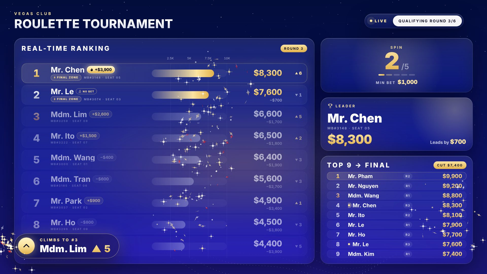

---

## Mục lục

1. [Cấu trúc repo](#1-cấu-trúc-repo)
2. [Chạy thử nhanh](#2-chạy-thử-nhanh)
3. [Các màn hình và đường dẫn](#3-các-màn-hình-và-đường-dẫn)
4. [Quy trình vận hành một giải](#4-quy-trình-vận-hành-một-giải)
5. [Lớp đồng bộ dữ liệu (Sync layer)](#5-lớp-đồng-bộ-dữ-liệu-sync-layer)
6. [Mô hình dữ liệu](#6-mô-hình-dữ-liệu)
7. [Kiến trúc code](#7-kiến-trúc-code)
8. [Quy tắc nghiệp vụ](#8-quy-tắc-nghiệp-vụ)
9. [Hiệu ứng](#9-hiệu-ứng)
10. [Nhập danh sách từ Excel](#10-nhập-danh-sách-từ-excel)
11. [Tra cứu thành viên qua API](#11-tra-cứu-thành-viên-qua-api)
12. [Assets và design tokens](#12-assets-và-design-tokens)
13. [Đa ngôn ngữ](#13-đa-ngôn-ngữ)
14. [Phụ thuộc bên ngoài và trình duyệt](#14-phụ-thuộc-bên-ngoài-và-trình-duyệt)
15. [Bảo mật và việc cần làm khi triển khai thật](#15-bảo-mật-và-việc-cần-làm-khi-triển-khai-thật)
16. [Kiểm thử đã thực hiện](#16-kiểm-thử-đã-thực-hiện)
17. [Ảnh chụp màn hình](#17-ảnh-chụp-màn-hình)

---

## 1. Cấu trúc repo

```
roulette-tournament-live/
├── .gitignore / .gitattributes / .nojekyll
├── index.html                      Ứng dụng hoàn chỉnh (1 file, ~400 KB, đã nhúng ảnh huy chương)
├── README.md                       Tài liệu này
├── adapters/
│   ├── local-sync-adapter.js       Đồng bộ giữa các tab/cửa sổ trên CÙNG một trình duyệt (để test)
│   └── firebase-adapter.example.js Ví dụ adapter Firestore cho nhiều máy (chưa chạy thử, xem §5)
├── assets/
│   ├── medals/                     5 ảnh webp nền trong suốt dùng ở màn hình trao giải
│   │   ├── medal-1-gold.webp         Champion (504×460)
│   │   ├── medal-2-copper.webp       Runner-up 1 (504×460)
│   │   ├── medal-3-silver.webp       Runner-up 2 (417×380)
│   │   ├── star-4th-bluegreen.webp   Giải 4 (245×220)
│   │   └── star-5th-pink.webp        Giải 5 (245×220)
│   ├── brand/
│   │   ├── diamond-gold.svg        Viên kim cương thương hiệu (confetti, icon)
│   │   └── diamond-ruby.svg
│   └── reference/                  Tài liệu gốc do Marketing cung cấp
│       ├── medal-sources/          Ảnh huy chương/ngôi sao gốc (nền tối, PNG 1329×1183)
│       ├── prize-table.jpg         Bảng giải thưởng
│       ├── podium-layout.jpg       Bố cục bục trao giải
│       ├── rules-qualifying-final.png  Luật vòng loại / chung kết
│       └── old-app.png             Giao diện app cũ (tham khảo)
├── data/
│   ├── config.default.json         Cấu hình mặc định (DEFAULT_CONFIG trong code)
│   ├── round.sample.json           Ví dụ document một vòng đấu
│   └── seat.sample.json            Ví dụ document trạng thái một ghế
├── templates/
│   └── Tournament_players_template.xlsx   File mẫu nhập danh sách người chơi
└── screenshots/                    16 ảnh chụp các màn hình chính (1920×1080 / 1600×1000)
```

Bản đang chạy trên claude.ai: `https://claude.ai/artifact/9RTzPb7dYCF4vuzE4DFsaP` (riêng tư, chủ sở hữu cần chia sẻ quyền). Bản trong repo này chỉ khác bản đó ở 3 điểm:

- Có khung HTML đầy đủ (`<!doctype>`, `<head>`, `<body>`).
- Có dòng nạp `adapters/local-sync-adapter.js`.
- Hai dòng ghi chú trong admin đã được viết lại cho ngữ cảnh tự host (API và local mode).

---

## 2. Chạy thử nhanh

**Chạy qua HTTP (khuyến nghị):**

```bash
cd roulette-tournament-live
python3 -m http.server 8080        # hoặc: npx serve .
```

Mở các tab trong **cùng một trình duyệt**:

| Tab | Địa chỉ |
|---|---|
| Admin | http://localhost:8080/#admin |
| Khách ghế 1 | http://localhost:8080/#seat1 |
| Khách ghế 2 | http://localhost:8080/#seat2 |
| Màn hình khán giả | http://localhost:8080/#audience |
| Demo tự chạy | http://localhost:8080/#demo |

Nhờ `local-sync-adapter.js`, mọi thao tác ở tab admin hiện ngay trên các tab khác, và khách bấm No Betting Chance thì admin thấy ngay. Adapter này chỉ đồng bộ trong một trình duyệt trên một máy. Muốn nhiều máy thật cần backend (§5).

- **Xoá dữ liệu test:** chạy `rtResetLocalTournament()` trong DevTools console.
- **Mở trực tiếp file `index.html`** (không qua HTTP) vẫn chạy được. Nếu không có adapter, app chạy ở *local mode*: mỗi màn hình giữ dữ liệu riêng và admin hiện ghi chú "Local mode".


### Chạy trên GitHub Pages

1. Trên GitHub: **Settings → Pages → Build and deployment**. Chọn Source = *Deploy from a branch*, Branch = `main`, thư mục `/ (root)`, rồi **Save**.
2. Sau 1–2 phút, app có tại `https://<tài-khoản>.github.io/roulette-tournament-live/`. Thêm đuôi `#admin`, `#seat1`, `#audience`.

Lưu ý:

- GitHub Pages chỉ phục vụ file tĩnh. Với adapter mặc định, mỗi trình duyệt là một giải riêng. Muốn nhiều máy dùng chung một giải vẫn cần backend (§5).
- Pages cho repo **private** cần gói GitHub trả phí (Pro, Team hoặc Enterprise).
- File `.nojekyll` giúp GitHub phục vụ file nguyên trạng.
---

## 3. Các màn hình và đường dẫn

Một file, phân vai bằng phần đuôi `#` của URL. Giá trị được lưu vào `localStorage` (`vg_seat`), nên lần sau mở không cần đuôi vẫn nhớ vai trò.

| Đường dẫn | Vai trò | Ghi chú |
|---|---|---|
| `#admin` | Bảng điều khiển + xem trước | Console 640px ghim bên phải, màn hình xem trước co giãn bên trái. Tab **Screens** chọn xem trước dưới dạng ghế nào hoặc màn hình khán giả. |
| `#seat1` … `#seat20` | Màn hình khách tại ghế | Chào khách theo tên, nút No Betting Chance, chọn ngôn ngữ, hiệu ứng cá nhân "That's you". (`#machine3`, `#m3` cũng được.) |
| `#audience` (hoặc không có đuôi, `#lobby`, `#tv`, `#bigscreen`) | Màn hình lớn cho khán giả | Hiện tên người chơi, chênh lệch với người dẫn đầu, điểm thắng/thua mỗi spin, giải thưởng theo hạng ở Final, thông báo kiểu truyền hình. Không có nút bấm. |
| `#demo` | Demo tự chạy | Chạy toàn bộ quy trình bằng dữ liệu mẫu, không ghi gì vào dữ liệu chung. |

- **Màn hình khách:** khách chỉ đổi được ngôn ngữ. Nhân viên mở cài đặt màn hình (chọn ghế, ngôn ngữ, toàn màn hình) bằng cách **giữ tiêu đề khoảng 1 giây**, di chuột, hoặc phím `S`.
- **Phím tắt:** `F` toàn màn hình, `S` mở cài đặt, `Esc` đóng.

Sân khấu luôn có kích thước cố định **1920×1080** và được co giãn (`transform: scale`) cho vừa mọi màn hình (hàm `fit()`).

---

## 4. Quy trình vận hành một giải

Mặc định: 6 vòng loại × 9 người × 5 spin. Top 9 tổng (lấy điểm cao nhất của mỗi member) vào Final: 9 người, 7 spin, 5 hạng giải.

1. **Seat setup**
   - Chọn vòng.
   - Nhập danh sách: tải Excel/CSV, dán từ Excel, hoặc gõ tay từng dòng (ghế, member #, danh xưng, họ, ngôn ngữ).
   - Bấm **Open Round X on all screens**. Tất cả màn hình chuyển sang màn hình chờ chào "Welcome Mr. X · 8 đối thủ".
2. **Run round → Show rules**: MC đọc luật, các ô luật lần lượt được làm nổi bật.
3. **Start → show ranking**: hiện bảng xếp hạng.
4. **Bấm số spin** (1…5) khi dealer bắt đầu. Màn hình hiện "Now · Spin X" kèm **Min bet** của spin đó.
5. **Nhập điểm**: gõ tổng điểm từng ghế rồi bấm **Show results**. Mọi màn hình cập nhật cùng lúc kèm hiệu ứng.
6. **Buy-in** (bật/tắt riêng cho vòng loại và Final):
   - Chỉnh Min / Max / Per ($) / Credits ngay trong Run round.
   - **Buy-in open** đưa mọi màn hình sang màn hình buy-in.
   - **Buy-in close** hiện "Buy-in closed" rồi quay lại bảng xếp hạng.
7. Lặp lại cho từng vòng. Sau vòng loại cuối, bấm **Send top 9 to Final** (hoặc ở Seat setup của Final: "Fill with the top 9").
8. **Final**: quy trình giống vòng loại. Kết thúc bằng **End the Final · show prize ranking**, màn hình trao giải xuất hiện (giải 5 → 4 → hạng 3 → hạng 2 → Champion).

**No Betting Chance:**

- Mỗi khách được dùng 1 lần mỗi vòng, bấm trên màn hình của mình.
- Trạng thái thẻ: còn dùng được → **Active · spin N** (nổi bật) → **Used · spin N** (mờ, sau khi admin chuyển sang spin kế tiếp).
- Admin sửa được ở cột NB trong Run round.

---

## 5. Lớp đồng bộ dữ liệu (Sync layer)

Ứng dụng **không gắn cứng với backend nào**. Khi khởi động, app gọi:

```js
const db   = await window.claude.use("db");    // object kiểu Firestore
const user = await window.claude.use("user");  // tuỳ chọn: user.can("data.write") -> Promise<boolean>
```

Nếu `window.claude` không có (hoặc `use("db")` trả về null), app chạy local mode. Trên claude.ai, object này do nền tảng cung cấp. Khi tự host, **một file adapter** đặt trước script chính sẽ cung cấp nó.

### Hợp đồng API mà adapter phải cung cấp

| Lời gọi | Dùng cho | Yêu cầu |
|---|---|---|
| `db.doc(path).onSnapshot(next, error)` | `tourney/config`, `tourney/q1…q20`, `tourney/final` | Gọi `next(snap)` ngay với giá trị hiện tại và mỗi khi đổi. `snap.exists` (boolean), `snap.data()` trả về object. Trả về hàm huỷ. |
| `db.doc(path).set(data)` | Mọi lần ghi | Ghi **thay thế toàn bộ** document. Trả về Promise. Lỗi `{code:"invalid_argument"}` khiến app chuyển màn hình đó sang chỉ xem; `{code:"quota_exceeded"}` hiện thông báo hết dung lượng. |
| `db.collection("seats").onSnapshot(next)` | Trạng thái các ghế | `next({ docs: [{ id, data() }] })` với **toàn bộ** document trong collection, mỗi khi có thay đổi. |
| `user.can("data.write")` | Quyền ghi | `false` thì màn hình đó không ghi gì, kể cả No Betting Chance. Nên trả `true` cho mọi màn hình đã đăng nhập và giới hạn quyền bằng luật phía server. |

Chi tiết hành vi:

- **Chống "dội" (echo):** khi một màn hình đang ghi `path`, nó bỏ qua snapshot của chính `path` đó cho tới khi ghi xong (`inflight[path]`). Adapter có thể phát snapshot ngay khi `set()` được gọi.
- **Debounce:** cấu hình ghi sau 0–700 ms, điểm số ghi ngay khi bấm Show results, ghế ghi ngay.
- **Không có transaction.** Ghi sau cùng thắng. Mỗi ghế ghi vào document riêng nên không giẫm lên nhau.

### Các lựa chọn triển khai

| Lựa chọn | Ghi chú |
|---|---|
| `adapters/local-sync-adapter.js` | Có sẵn, đã test. Dùng `localStorage` và sự kiện `storage`. Chỉ đồng bộ trong 1 trình duyệt/1 máy, hợp để dev và demo. |
| Firebase Firestore | `adapters/firebase-adapter.example.js`. API "compat" của Firestore có sẵn đúng `doc().onSnapshot/set` và `collection().onSnapshot`, nên chỉ cần bọc mỏng. **Chưa chạy thử** (không có project Firebase). Cần điền config và viết security rules. |
| Backend riêng (WebSocket / Supabase / Socket.IO…) | Viết adapter theo bảng trên: server lưu document theo `path` (JSON), push thay đổi tới mọi client đang nghe. Khoảng 80–150 dòng phía client. |

Thay dòng `<script src="adapters/local-sync-adapter.js"></script>` trong `<head>` của `index.html` bằng adapter đã chọn.

---

## 6. Mô hình dữ liệu

### Document dùng chung

| Path | Ai ghi | Nội dung |
|---|---|---|
| `tourney/config` | Admin | Toàn bộ cấu hình và trạng thái điều khiển (xem dưới và `data/config.default.json`) |
| `tourney/q1` … `tourney/q20` | Admin | `{ players: Player[], updatedAt }`: danh sách và điểm của vòng loại N |
| `tourney/final` | Admin | Như trên, cho Final |
| `seats/{round}-s{seat}` (vd. `seats/q3-s5`, `seats/final-s2`) | Màn hình khách (và admin khi sửa NB) | `{ session, lang?, langAt?, noBet?, noBetAt? }` (`data/seat.sample.json`) |

**Player** (`data/round.sample.json`):

```json
{ "seat": 3, "member": "100505", "score": 11650, "title": "Mr.", "name": "Tanaka", "lang": "ja", "langAt": 1760000000000 }
```

- `score` là **tổng điểm hiện tại**, không phải số cộng thêm.
- `lang` rỗng nghĩa là dùng ngôn ngữ mặc định.
- `langAt` (ms) dùng để chọn ngôn ngữ mới nhất (§8).

### Các trường quan trọng trong `tourney/config`

| Trường | Ý nghĩa |
|---|---|
| `stage` | `"qual"` hoặc `"final"` |
| `qualIndex` | Vòng loại đang chạy (1…) |
| `mode` | `standby` (chào) · `rules` · `live` (xếp hạng) · `buyin` · `awards` (trao giải) |
| `currentSpin`, `spinSeq` | Spin hiện tại; `spinSeq` tăng mỗi lần bấm, để kích hoạt màn "Now · Spin" kể cả khi bấm lại cùng số |
| `session` | Tăng mỗi lần mở vòng. Document `seats/*` có `session` cũ bị bỏ qua, nên No Betting Chance và ngôn ngữ khách được reset |
| `awardSeq` | Tăng để chạy lại hiệu ứng trao giải |
| `qual` | `{ rounds, players, spins, advance }`. Giới hạn: rounds 1–20, players 1–30, spins 1–20 |
| `final` | `{ players, spins, prizes }`. `prizes` là số hạng phía trên vạch "Prize line" |
| `buyIn.qual` / `buyIn.final` | `{ enabled, min, max, unit, rate }`: "$unit = rate credits" |
| `minBet.qual` / `minBet.final` | `{ base, spins: [] }`: `spins[i] > 0` ghi đè min bet của spin i+1 |
| `prizes` | `{ title, tiers: [{ key: champ\|ru1\|ru2\|p4\|p5, amount, type, count }] }`. `count` chỉ áp dụng cho p4, p5 |
| `rules.qual` / `rules.final` | Tối đa 5 ô luật `{ icon, value, label, ko, zh, ja }` |
| `effects` | `{ rowFx, personal, leader, top9, callouts, particles, bgMotion, sound, overlaySec, spinSec }` |
| `lang`, `eyebrow`, `title`, `currency`, `buyInSymbol`, `scaleMode`, `scaleMax`, `pin` | Hiển thị chung |

Khi đọc, config luôn được trộn với `DEFAULT_CONFIG` (`deepMerge`). Thêm trường mới vào code là đủ, không cần migrate dữ liệu cũ.

### localStorage trên từng máy

| Khoá | Nội dung |
|---|---|
| `vg_seat` | Vai trò màn hình: `0` = khán giả, `1…20` = ghế |
| `vg_lobby_lang` | Ngôn ngữ của màn hình khán giả |
| `vg_guest` | Bản sao cục bộ lựa chọn của khách (ngôn ngữ, No Betting Chance) phòng khi mất kết nối |
| `vg_api` | Cấu hình API tra cứu thành viên, **chỉ trên máy admin** |
| `vg_demo` | Demo đang bật |
| `rt_db:*` | Dữ liệu của `local-sync-adapter.js` |

---

## 7. Kiến trúc code

Một `<style>` và một `<script>` (IIFE, `"use strict"`), chia theo các khối chú thích `/* ===== … ===== */`:

| Khối | Nội dung chính |
|---|---|
| constants | `I18N` (EN/KO/ZH/JA, 83 khoá), `DEFAULT_CONFIG`, `ICONS` (SVG inline), `MEDAL` (5 ảnh webp base64), `DPATH_D` (path kim cương) |
| state | `shared` = `{ cfg, rounds, seats }` lấy từ server. `cfg`/`rounds`/`seats` trỏ vào `shared` hoặc dữ liệu demo. `readHash()` |
| utils | `fmt`, `money`, `rankList`, `overallList`, `fullName`, `dispName`, `setHTML` (chỉ ghi DOM khi markup đổi) |
| per-seat state | `langFor(seat)`, `noBetFor(seat)`, `curLang()`, `T(key, vars)` |
| stage scaling / background / particles / sound | `fit()`; canvas nền (sao + sóng chấm); confetti kim cương (`burst`, `rain`); chuông Web Audio (`chime`) |
| overlays | Hàng đợi hiệu ứng toàn màn hình: `queueOverlay`, `ovSpin/spinOv`, `ovLeader`, `ovRankUp`, `ovNoBet`, `ovBuyClose` |
| audience screen | Thông báo kiểu lower-third (`queueCallout`), điểm thay đổi mỗi spin (`aud.deltas`), thẻ Leader (`renderLead`), thẻ "Spin N · top gains" (`renderRecap`) |
| live ranking | `renderLive` (hàng định vị tuyệt đối, chuyển động FLIP bằng `transform`), `renderTop` (Top 9 tổng) |
| header, side cards… | `renderHeader`, `renderSpin`, `renderPos` (thẻ No Betting Chance), `renderViews` (chào, luật, buy-in), `renderAwards` + `manageAwards` (trao giải) |
| change detection | `processAll(allowFx)`: so sánh hạng/điểm với lần trước để quyết định hiệu ứng. `afterChange(prevState)` xử lý chuyển `mode`/spin/vòng |
| data | `applyConfig`, `applyRound`, `ensureSubs`, `persist` (debounce, chuỗi Promise theo path), `initData` |
| guest actions | `setGuestLang`, `useNoBet` |
| admin actions / demo | `openRound`, `promoteTop`; demo chạy bằng `demoRun()` (async, huỷ được) |
| admin console | `runView`, `setupView` (+ import Excel), `apiView`, `formatView`, `rulesView`, `effectsView`, `prizesView`, `screensView`, `guestView`; xử lý sự kiện bằng delegation trên `#sheet` (`data-act`, `data-cfg`, `data-pl`…) |
| controls / boot | Nút toàn màn hình/cài đặt, phím tắt, wake lock, khởi động |

**Luồng render:** dữ liệu đổi (snapshot hoặc admin thao tác) → `applyConfig`/`applyRound` → `afterChange` → `renderAll()` = `renderHeader()` + `renderViews()` + `processAll()`. Mọi màn hình chạy cùng code; vai trò (`effSeat()`, `isAud()`) quyết định phần nào hiện.

**Chỗ thường cần sửa:**

- Chữ trên màn hình: `I18N`.
- Màu: biến CSS trong `:root`.
- Luật mặc định, buy-in, min bet, giải thưởng: `DEFAULT_CONFIG` (hoặc chỉnh ngay trong admin).
- Ảnh huy chương: `MEDAL` (thay `data:` URI bằng đường dẫn file trong `assets/medals/` nếu muốn tách).

---

## 8. Quy tắc nghiệp vụ

| Chủ đề | Quy tắc (hàm trong code) |
|---|---|
| Xếp hạng vòng | Điểm giảm dần; bằng điểm thì đồng hạng (1, 1, 3…), thứ tự hiển thị theo số ghế (`rankList`, `assignRanks`) |
| Top Players (vòng loại) | Mỗi member lấy **điểm cao nhất** qua các vòng đã chơi tới vòng hiện tại; bằng điểm thì vòng sớm hơn đứng trước (`overallList`). Top `qual.advance` người là "Final zone", có vạch "Cut" |
| Gửi vào Final | `promoteTop()` chép top N tổng (ghế 1…N, điểm 0, giữ danh xưng/họ) vào `tourney/final` |
| Giải thưởng | Cắt bảng xếp hạng Final theo `count` từng hạng: 1, 1, 1, rồi p4 × n, p5 × n (`awardList`). Bằng điểm thì theo số ghế |
| Ngôn ngữ một ghế | Lấy lựa chọn **mới nhất** (`langAt`) giữa: admin đặt trong danh sách, khách chọn (document `seats/*`), bản cục bộ của khách. Không có thì dùng `cfg.lang` (`langFor`) |
| No Betting Chance | `seats/*.noBet` = số spin đã dùng. Active khi `noBet >= currentSpin`, Used khi admin đã sang spin sau. Mỗi `session` một lần (`noBetFor`, `renderPos`) |
| Buy-in | Màn hình hiện tối đa 5 mức từ `min` tới `max`, bước là bội số của `unit`; credits = số tiền / unit × rate |
| Min bet | `minBetFor(n)`: `minBet[stage].spins[n-1]` nếu > 0, ngược lại `base` |
| Ô luật tự đồng bộ | Ô có icon `buyin` (hoặc `ban` + nhãn Buy-in) theo cấu hình buy-in (bật/tắt, $unit = rate). Ô icon `chip` theo min bet chung (`syncRuleTiles`) |
| Tên hiển thị | `Mr. Họ`. Không có họ thì màn chào ghi "Valued Guest" (theo ngôn ngữ), nơi khác ghi `MB#số` (`greetName`, `dispName`) |

---

## 9. Hiệu ứng

| Hiệu ứng | Màn hình | Điều kiện | Tắt/bật (`effects.*`) |
|---|---|---|---|
| Now · Spin X + Min bet | Tất cả | Admin bấm số spin. Spin cuối có "Last spin" | `spinSec` (độ dài) |
| Hàng leo hạng (gold sweep + confetti) | Tất cả | Hạng tăng sau Show results | `rowFx` |
| New Leader (toàn màn hình) | Tất cả | Final: người dẫn đầu vòng đổi. Vòng loại: người dẫn đầu Top Players đổi. Khán giả thấy tên | `leader` |
| That's you · Rank up | Chỉ ghế đó | Hạng của chính khách tăng | `personal` |
| Top 9 entry | Chỉ ghế đó | Khách lọt top 9 tổng | `top9` (mặc định tắt) |
| No Betting Chance | Ghế đó | Khách bấm dùng | — |
| Buy-in closed | Tất cả | Admin chuyển từ `buyin` về `live` | `overlaySec` |
| Thông báo lower-third | Khán giả | Sau mỗi Show results: lên dẫn đầu, thắng lớn nhất spin, lên top 3, vào Final zone, cạnh tranh sát nút (chênh ≤ max($500, 5%)), ai đó dùng No Betting Chance. Mỗi người tối đa 1 lần mỗi lượt, tối đa 4 thông báo | `callouts` |
| Chip +/− điểm, chênh lệch với hạng 1, giải theo hạng (Final) | Khán giả | Luôn hiện | — |
| Khung bảng "thở" vàng | Khán giả | Spin cuối | — |
| Trao giải (bục, huy chương rơi, đếm tiền, mưa kim cương) | Tất cả | `mode = awards`. Chạy lại bằng `awardSeq` | `particles` |
| Confetti kim cương, nền động, âm thanh | Tất cả | — | `particles`, `bgMotion`, `sound` |

Thời gian màn trao giải: giải 5 lúc 0,5 s, giải 4 lúc 0,9 s, hạng 3 lúc 1,6 s, hạng 2 lúc 2,7 s, Champion lúc 4,0 s, lời chúc mừng lúc 6,2 s. Hệ thống tôn trọng `prefers-reduced-motion`.

---

## 10. Nhập danh sách từ Excel

Ở tab **Seat setup**: nút **Upload Excel or CSV**, hoặc **Paste from Excel** (dán dữ liệu TSV copy từ Excel).

- **Định dạng đọc được:**
  - `.xlsx`: bộ đọc tự viết (zip + `DecompressionStream` + `DOMParser`), không cần thư viện, chỉ đọc sheet đầu tiên.
  - `.csv` / `.tsv` / `.txt`: tự nhận dấu phân cách (`,` `;` tab), có ngoặc kép, BOM, UTF-16. Mã hoá UTF-8, EUC-KR, Shift-JIS, GB18030, Big5, Windows-1258/1252 được tự chọn bằng cách chấm điểm tiêu đề nhận ra được.
  - Bảng HTML được lưu dưới đuôi `.xls`.
  - `.xls` nhị phân cũ: tải SheetJS 0.18.5 từ cdnjs khi cần (cần internet).
- **Cột nhận dạng** (tiêu đề tiếng Anh/Việt/Hàn/Trung/Nhật, không phân biệt hoa thường/dấu):
  - **Member #** (bắt buộc)
  - Title (Mr/Mdm/Ms/Mrs, Ông/Bà, Male/Female, 남/여, 先生/女士…)
  - Surname (hoặc Name)
  - Language (EN/KO/ZH/JA, English, 한국어, 中文, 日本語, Tiếng Anh…)
  - Seat
  - **Round** (1…N hoặc Final): một file điền được nhiều vòng
- **Không có dòng tiêu đề** thì app đoán cột theo nội dung.
- **Bảng xem trước:** hiện trước khi lưu, kèm cảnh báo:
  - thiếu member → bỏ qua dòng
  - trùng member trong vòng → bỏ qua
  - ghế trùng → chuyển sang ghế trống
  - ngôn ngữ lạ → dùng mặc định
  - vòng không tồn tại → bỏ qua dòng
- **Apply** ghi đè danh sách vòng đó (giữ điểm nếu member đã có). Sau đó vẫn sửa tay được bình thường.
- **Số 0 ở đầu** của số member được giữ nguyên.
- Nếu đã cấu hình API, dòng thiếu họ sẽ được tra tự động.

File mẫu: `templates/Tournament_players_template.xlsx`. Sheet `Players` có danh sách chọn cho Title, Language, Round. Sheet `Guide` giải thích từng cột. Hàm liên quan: `rowsFromFile`, `readXlsx`, `decodeText`, `parseDelimited`, `buildImport`, `applyImport`.

---

## 11. Tra cứu thành viên qua API

Tab **API** trên máy admin:

- `url` có `{member}`, ví dụ `https://api.example.com/members/{member}`.
- Header khoá tuỳ chọn (tên + giá trị).
- Tên trường danh xưng/họ (hỗ trợ path dạng `data.lastName`).

Khi gõ số member ở Seat setup, admin gọi `fetch(GET)`, timeout 6 s. Nếu không chỉ định trường, app tự thử: `title, salutation, prefix` / `lastName, surname, familyName, last_name, name` (cả trong `data.*`, `result.*`). Trả về 404 nghĩa là "không tìm thấy".

- Cấu hình chỉ lưu ở `localStorage` máy admin, không bao giờ ghi vào dữ liệu chung.
- Trình duyệt gọi thẳng API, nên **API phải bật CORS** cho domain chứa app. Tốt hơn là đặt một proxy cùng domain để giấu khoá (§15).
- Bản trên claude.ai không gọi được server ngoài (chính sách bảo mật của nền tảng). Bản tự host thì gọi được.

---

## 12. Assets và design tokens

| Asset | Dùng ở | Ghi chú |
|---|---|---|
| `assets/medals/*.webp` | Màn hình trao giải | Đã nhúng trong `MEDAL` (index.html). Được cắt nền từ ảnh gốc trong `reference/medal-sources/` (flood-fill từ viền + alpha mềm) |
| `assets/brand/diamond-*.svg` | Confetti, icon "You", chip Final zone | Path: `M108.5 0C118 122 150 181 217 207 150 233 118 292 108.5 414 99 292 67 233 0 207 67 181 99 122 108.5 0Z` (viewBox 217×414). Confetti vẽ bằng canvas với gradient vàng/ruby/trắng |
| Font | Toàn app | Google Fonts: **Montserrat** (300–900), **Gothic A1** (KO), **Noto Sans SC** (ZH), **Noto Sans JP** (JA). Nếu địa điểm hạn chế internet, nên tự host font |
| Icon | Luật, buy-in, khoá… | SVG inline trong `ICONS` |

**Design tokens** (`:root`):

| Token | Giá trị | Dùng cho |
|---|---|---|
| `--ground-0/1/2` | `#020d3b` `#0c1162` `#241a86` | Nền tím vũ trụ |
| `--gold-hi` / `--gold-lo` | `#fbe4a2` / `#e2b24b` | Gradient vàng thương hiệu |
| `--ruby` | `#ed1c24` | Chỉ dùng cho viên kim cương |
| `--silver-*`, `--bronze-*` | | Hạng 2, 3 |
| `--ink` | `#0b0c22` | Chữ trên nền sáng |
| `--glass-*` | rgba trắng 4–16% | Kính mờ (`backdrop-filter: blur(28px)`) |

Lưu ý Safari: không dùng `filter` (blur/drop-shadow) trên phần tử có `background-clip:text` (chữ gradient), vì chữ sẽ bị mờ.

Thiết kế tham khảo design system thương hiệu: `https://claude.ai/code/artifact/8d386ae4-0d72-4d49-b200-d2edb8ebb11b` (riêng tư).

---

## 13. Đa ngôn ngữ

- 4 ngôn ngữ: `en`, `ko`, `zh`, `ja`, trong object `I18N`. Dùng `T("key", { n: 3 })` với biến `{n}`.
- Ô luật có `label` (EN) cùng `ko`, `zh`, `ja`.
- Mỗi ghế có ngôn ngữ riêng (§8). Màn hình khán giả và admin dùng ngôn ngữ chọn trong cài đặt màn hình hoặc `cfg.lang`.
- Thêm ngôn ngữ mới:
  1. Thêm một khối trong `I18N` (thiếu khoá nào sẽ dùng tiếng Anh).
  2. Thêm vào `LANGS` và `LANG_SHORT`.
  3. Thêm font nếu cần.
  4. Thêm alias vào `IMP_L` để nhập Excel nhận ra.

---

## 14. Phụ thuộc bên ngoài và trình duyệt

| Phụ thuộc | Khi nào | Bắt buộc? |
|---|---|---|
| fonts.googleapis.com / fonts.gstatic.com | Luôn luôn | Không (thiếu thì dùng font hệ thống) |
| cdnjs.cloudflare.com/ajax/libs/xlsx/0.18.5 | Chỉ khi nhập `.xls` cũ hoặc `.xlsx` lỗi | Không |
| API thành viên của câu lạc bộ | Khi admin cấu hình | Không |
| Backend đồng bộ (§5) | Để nhiều máy cùng chạy | Có (khi triển khai thật) |

**Trình duyệt:** Chrome/Edge 103+, Safari 16.4+, Firefox 113+. `DecompressionStream` dùng cho đọc `.xlsx`. Dùng thêm Screen Wake Lock (giữ màn hình sáng, nếu hỗ trợ) và Fullscreen API.

- **Màn hình ghế/khán giả:** nên chạy Chrome kiosk, ví dụ `chrome --kiosk "https://…/index.html#seat3"`.
- **Âm thanh:** cần chạm màn hình một lần (chính sách autoplay).

---

## 15. Bảo mật và việc cần làm khi triển khai thật

1. **Backend + xác thực:** chọn adapter (§5).
   - Màn hình khách chỉ nên **đọc** `tourney/*` và **ghi** `seats/*` (lý tưởng là đúng ghế của mình).
   - Chỉ tài khoản nhân viên được ghi `tourney/*`.
2. **PIN admin** (`cfg.pin`) chỉ chặn ở giao diện và nằm trong dữ liệu chung, không phải bảo mật thật. Thay bằng đăng nhập.
3. **Dữ liệu cá nhân:** tên và số member hiện trên màn hình công cộng và lưu trong dữ liệu chung. Cần đặt chính sách lưu/xoá sau giải.
4. **API thành viên:** đưa qua proxy phía server (cùng domain) để không lộ khoá và tránh CORS.
5. **Tự host font** nếu mạng ở sảnh bị giới hạn. Cân nhắc cache offline (Service Worker) cho màn hình.
6. **Chưa có:**
   - lịch sử/nhật ký thay đổi
   - xuất kết quả (CSV/PDF)
   - nhiều giải chạy song song (hiện một bộ document `tourney/*`; muốn nhiều bàn thì thêm tiền tố namespace vào path)
   - khôi phục khi admin ghi nhầm (chỉ có "Reset these scores")
7. **Giới hạn hiện tại:** tối đa 30 người/vòng, 20 vòng loại, 20 spin/vòng, 20 ghế trong bộ chọn màn hình.

---

## 16. Kiểm thử đã thực hiện

Kiểm thử tự động bằng Playwright (Chromium), độ phân giải 1920×1080 và 1600×1000:

- Toàn bộ quy trình: mở vòng → luật → xếp hạng → spin → nhập điểm → buy-in mở/đóng → Final → trao giải; chế độ demo chạy liên tục.
- Đồng bộ 2 cửa sổ qua `local-sync-adapter.js`:
  - admin mở vòng → ghế hiện lời chào đúng tên
  - spin → ghế hiện "Now · Spin 1 · Min bet"
  - khách dùng No Betting Chance → admin thấy "NB · S1"
- Màn hình khán giả: chip điểm, thông báo lower-third (thứ tự và thời gian), không báo lại No Betting Chance cũ khi màn hình vừa mở, spin cuối, Final với giải theo hạng.
- Ngôn ngữ EN/KO trên ghế, khán giả, trao giải, buy-in closed.
- Nhập dữ liệu:
  - `.xlsx` có cột Round (3 vòng), file mẫu đã điền
  - CSV UTF-8 có BOM và dấu `;`
  - CSV EUC-KR (tiêu đề tiếng Hàn), Shift-JIS, GB18030
  - dữ liệu dán không có tiêu đề
  - sửa tay sau khi nhập
- Cấu hình buy-in (min/max/tỷ lệ, bật/tắt vòng loại, ô luật tự đổi) và min bet theo từng spin.
- Không có lỗi JavaScript trong mọi kịch bản.

**Chưa kiểm thử:**

- adapter Firebase
- nhập `.xls` nhị phân (cần internet tới cdnjs)
- gọi API thành viên thật
- Safari / Firefox thực tế

---

## 17. Ảnh chụp màn hình

| | |
|---|---|
|  **01** Ghế · chào khách | 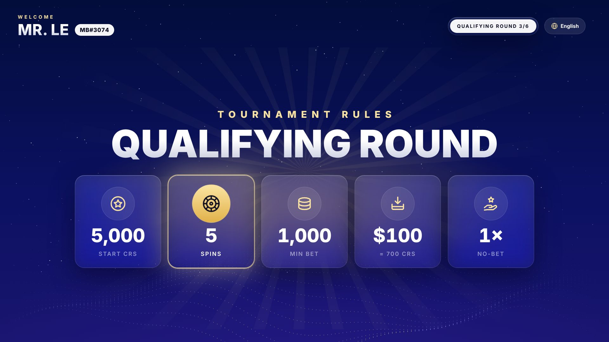 **02** Ghế · MC đọc luật |
| 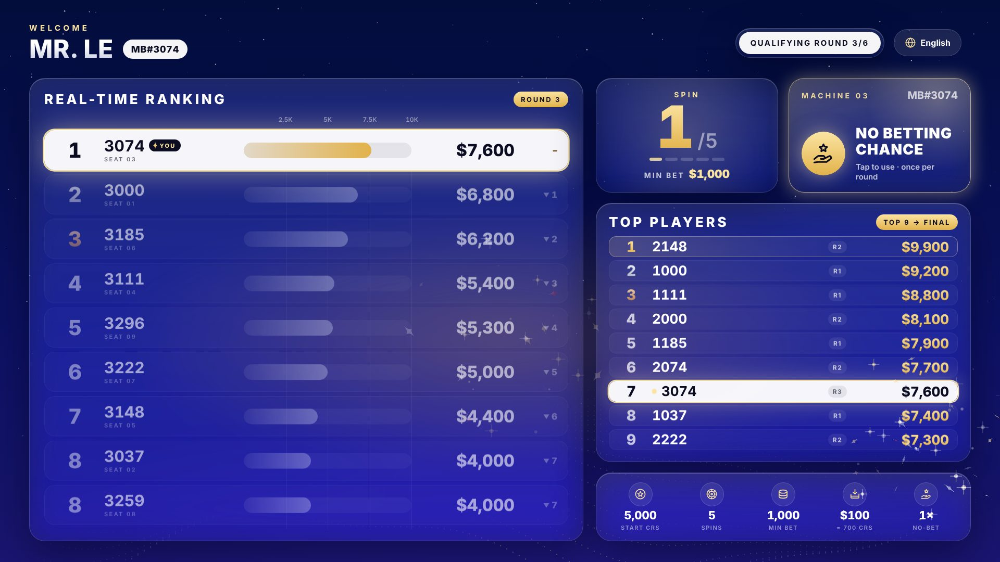 **03** Ghế · xếp hạng (ghế 3 được làm nổi bật) |  **04** Now · Spin + Min bet |
| 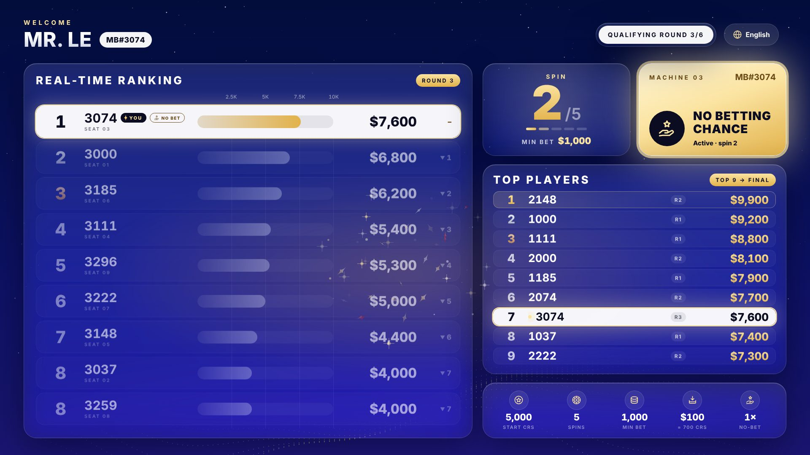 **05** No Betting Chance đang dùng | 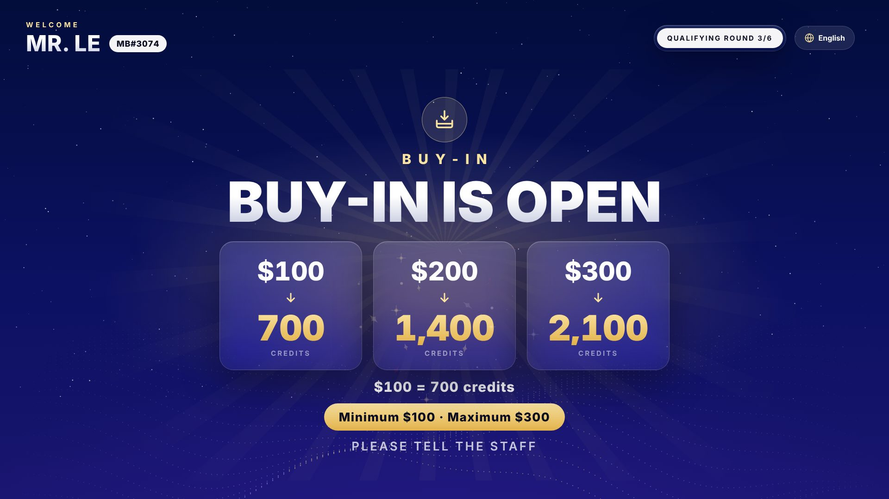 **06** Buy-in mở |
|  **07** Buy-in closed | 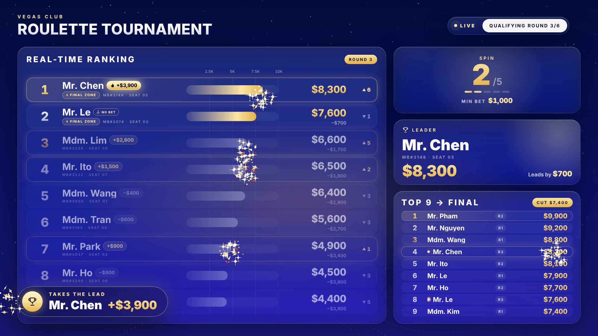 **08** Khán giả · vòng loại |
|  **09** Khán giả · thông báo lower-third | 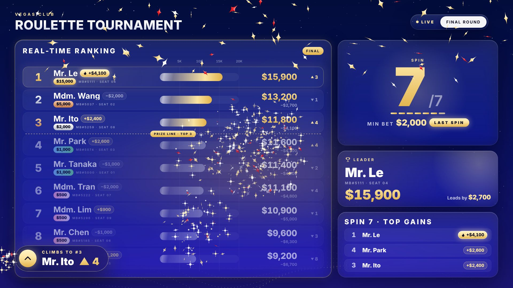 **10** Khán giả · Final, spin cuối |
| 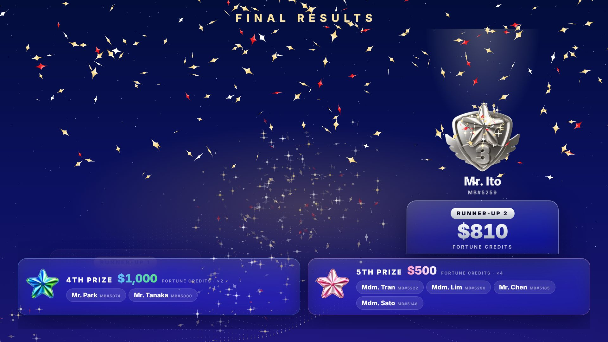 **11** Trao giải · đang lộ dần |  **12** Trao giải · hoàn tất |
| 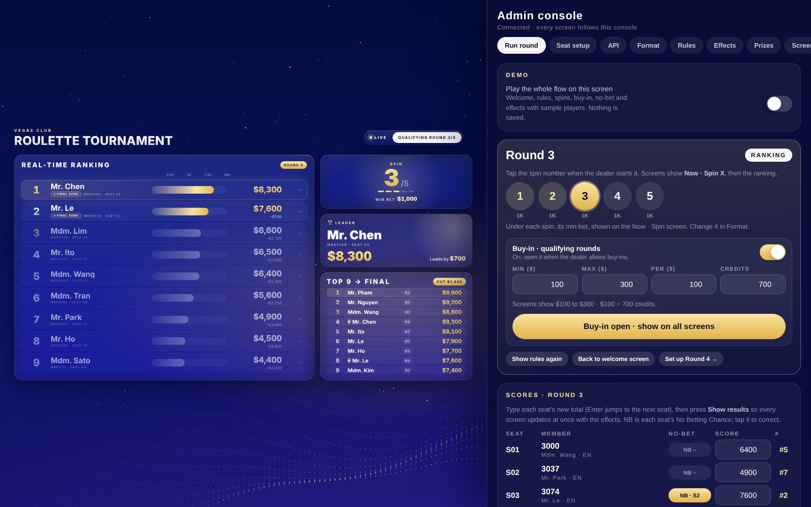 **13** Admin · Run round | 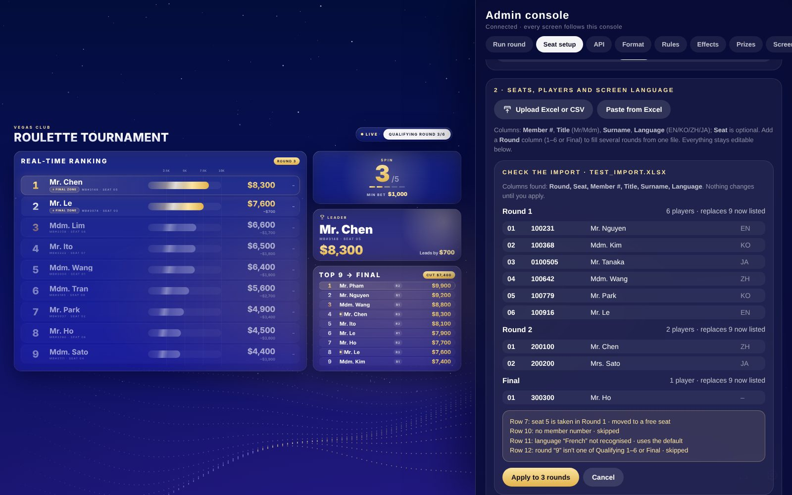 **14** Admin · nhập Excel (xem trước) |
| 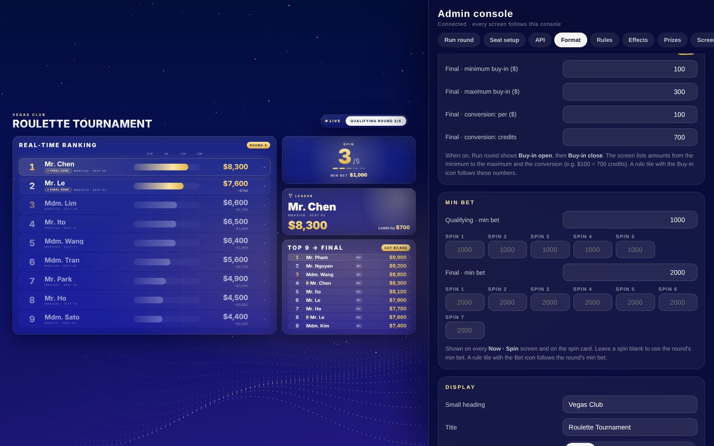 **15** Admin · Buy-in & Min bet | 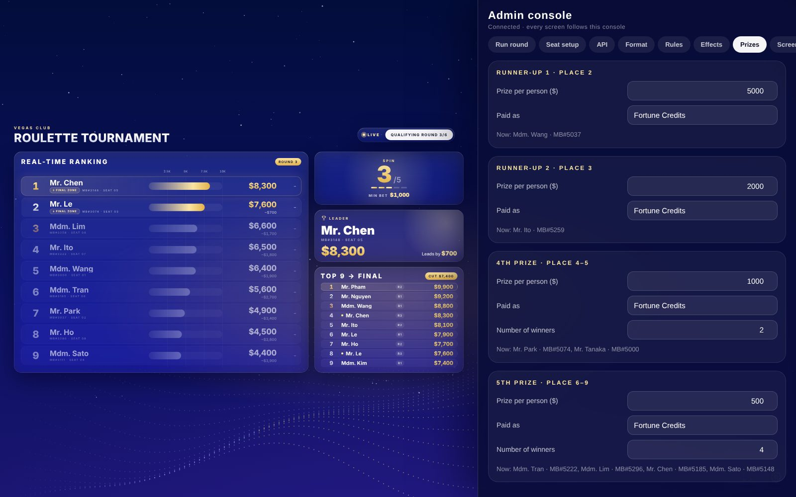 **16** Admin · Giải thưởng |

Tham khảo từ Marketing: [bảng giải thưởng](assets/reference/prize-table.jpg), [bố cục bục](assets/reference/podium-layout.jpg), [luật](assets/reference/rules-qualifying-final.png), [app cũ](assets/reference/old-app.png).
